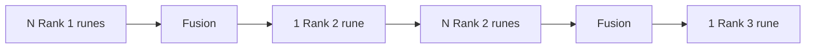

# Rank and Fusion

## Ranks

_How many ranks exist, and what separates them._

| Rank | Name | Capacity / slots | Notes |
|------|------|------------------|-------|
| 1 | _..._ | _..._ | _..._ |
| 2 | _..._ | _..._ | _..._ |
| 3 | _..._ | _..._ | _..._ |

## Fusion

_How runes combine into a higher-rank rune._

- **Requirement:** _how many runes, of what rank, and whether they must match_
- **Result:** _what the fused rune is_
- **Failure:** _what happens if a fusion goes wrong_

## Specialization vs. variety

_Does stacking copies of one rune beat mixing different ones? What are the trade-offs?_
